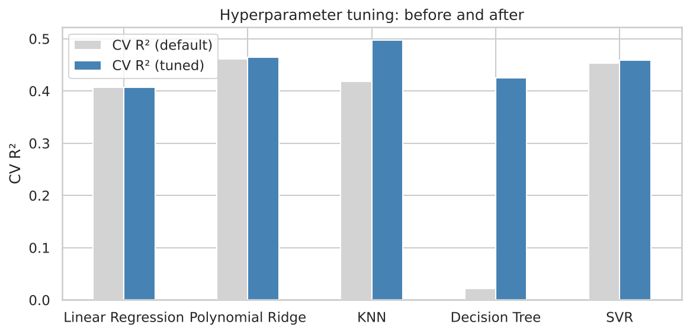
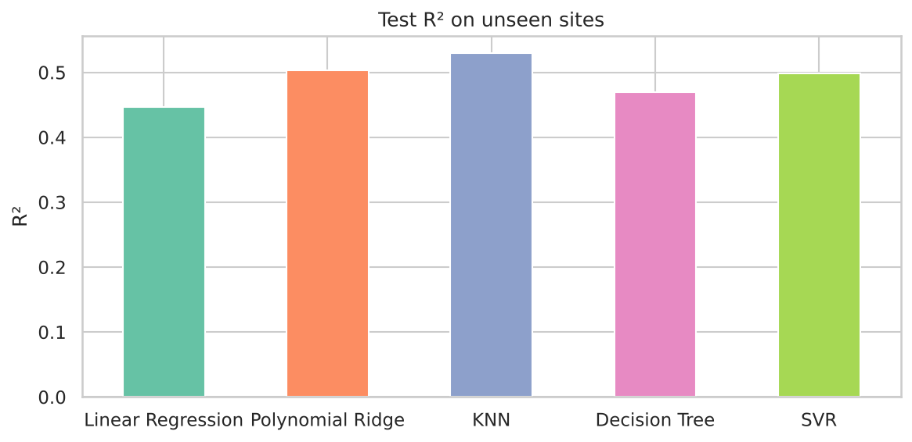
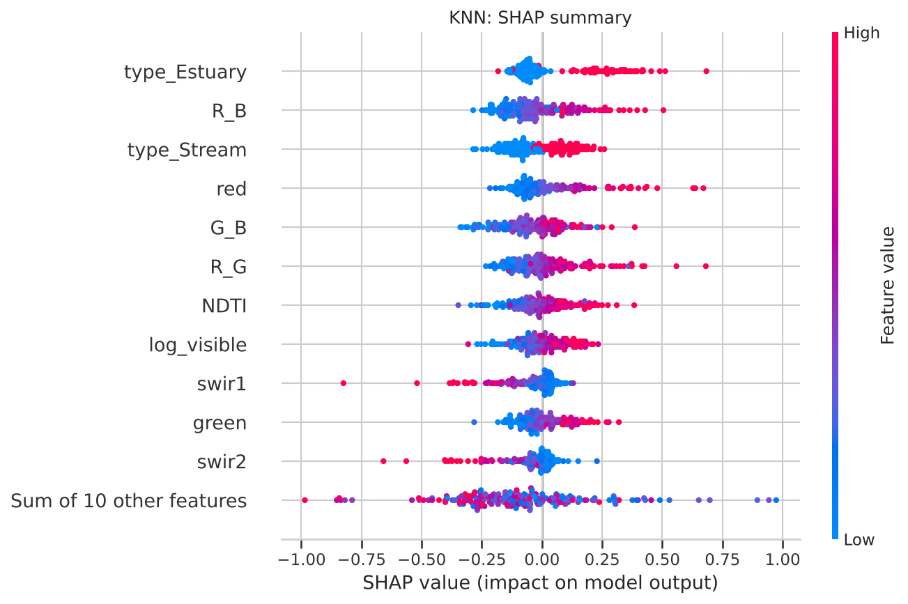
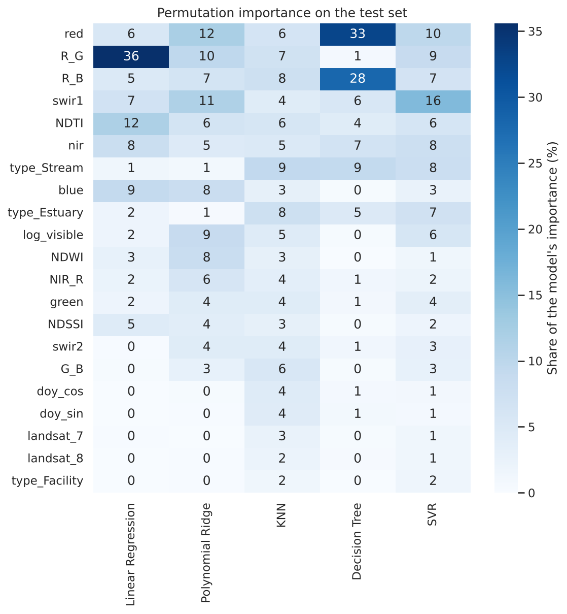

# Predicting Water Turbidity (TSS) from Landsat Imagery — Five-Model Comparison

**2107541 Machine Learning for Environmental Applications** · Project 2 · AY2026 Semester 1
Chulalongkorn University, Faculty of Engineering

**Contributor:** Chatrphol Ovanonchai (6730084521)

**Notebook:** [`notebooks/ML_analysis.ipynb`](notebooks/ML_analysis.ipynb) · **Figures:** [`figures/`](figures/)

> Branch `5-Model-Assignment` follows the Project 2 brief (≥ 5 models, tuning, explainable ML). It reuses the dataset and
> spectral features of the ensemble version on [`main`](https://github.com/NuBFightForMyDream/2107541_MLEnvi_Project_PredictingWaterTurbidityWithTSS/tree/main).

---

## Problem

**Total Suspended Solids (TSS, mg/L)** is a key indicator of water quality. High TSS comes from erosion, runoff and
construction; it blocks light, harms aquatic life and raises water-treatment costs. Field sampling is expensive, so most
water bodies are rarely sampled.

Suspended particles change the colour of water, and Landsat sees almost every water body every 8–16 days.
**Goal: predict TSS from satellite reflectance, so water quality can be monitored where nobody samples.**

## Dataset

[**AquaSat**](https://figshare.com/articles/dataset/AquaSat/8139383) (Ross et al., 2019, [doi:10.1029/2019WR024883](https://doi.org/10.1029/2019WR024883), CC BY 4.0):
US field water samples matched with Landsat 5/7/8 surface reflectance within ±1 day.

- 603,432 raw matchups → **128,603 after cleaning**, from **21,129 sites** (1984–2019)
- Streams 48.7 % · Estuaries 27.0 % · Lakes 23.5 % · Facility 0.8 %
- Stored as [`data/aquasat.csv.gz`](data/aquasat.csv.gz) (see [`data/README.md`](data/README.md))

## Research questions

1. **RQ1** — Can Landsat reflectance predict TSS at sites never used for training?
2. **RQ2** — Which of five basic models is best, and how much does tuning help?
3. **RQ3** — Does site context (water-body type, sensor) improve the prediction?
4. **RQ4** — Which features drive the predictions, and do they make physical sense?
5. **RQ5** — Where does the model fail?

## Methods

| Step | What was done |
|---|---|
| Target | `log(1 + TSS)` — TSS is extremely skewed (skewness 129 → 0.83) |
| Cleaning | TSS > 0 · valid reflectance · clear-water pixels (QA 68/324) · ≥ 50 % water |
| Features (21) | 6 bands · NDTI, NDWI, NDSSI · band ratios, brightness · season (sin/cos day of year) · **water-body type and Landsat sensor (one-hot)** |
| Outliers | Spectral features clipped to the 0.1–99.9th percentile of the training set |
| Split | 80 / 20 **by site** (`GroupShuffleSplit`) — no site in both sets |
| Models | Linear Regression · Polynomial Ridge · KNN · Decision Tree · SVR (RBF, trained on 15,000 rows) |
| Validation | 5-fold `GroupKFold`; tuning with `GridSearchCV`; test set used once |
| Explainability | Permutation importance (all models) · SHAP (best model) · decision-tree rules |

## Results

Scores on `log(1 + TSS)` for **sites never seen in training** (test = 4,226 sites, 26,461 matchups).

| Model | CV R² (default) | CV R² (tuned) | **Test R²** | Test MAE | Within 2× |
|---|---|---|---|---|---|
| Linear Regression | 0.407 | 0.407 | 0.447 | 0.628 | 65.6 % |
| Polynomial Ridge | 0.461 | 0.465 | 0.503 | 0.590 | 68.4 % |
| **KNN** | 0.418 | **0.497** | **0.529** | **0.547** | **70.7 %** |
| Decision Tree | 0.022 | 0.425 | 0.469 | 0.616 | 66.5 % |
| SVR | 0.454 | 0.459 | 0.499 | 0.590 | 68.6 % |

*Within 2×* = share of predictions between half and double the measured TSS.

**Best model: KNN** (`n_neighbors=30`, `weights="distance"`), chosen by cross-validation before using the test set.

- **Non-linear models beat linear regression** → the reflectance–TSS relationship is non-linear.
- **Tuning fixes over-fitting**: the default tree scores 0.993 on training sites but 0.022 on new sites; tuning lifts it to 0.425.
- **Site context helps every model** (+0.03 to +0.07 CV R²).
- **By water-body type**: streams R² 0.563 · lakes 0.440 · estuaries 0.287.
- **Turbidity classes** (Low < 10, Moderate 10–50, High ≥ 50 mg/L): 69.4 % accuracy vs. 44.7 % for always guessing "Moderate".

<p align="center">
  
  
</p>

## Feature importance

- **Red-band features** (`red`, `R_B`, `R_G`, `NDTI`) are the most important for all five models.
- **Water-body type** is also a top feature for KNN.
- SHAP: redder water → higher TSS; stream/estuary → higher TSS; high SWIR → lower TSS (glint or haze, not sediment).

<p align="center">
  
  
</p>

## Environmental interpretation

- **Physically sensible**: particles scatter red light, so turbid water looks brighter and redder.
- **Setting matters**: streams carry runoff sediment, tides stir estuaries, lakes let particles settle.
- **Good enough to** screen unsampled water bodies, target field sampling, and build long-term trends from the Landsat archive.
- **Not good enough to** replace field measurements for regulation.
- **Main weakness**: very turbid storm/flood plumes are under-predicted — rare in the data, and reflectance saturates.

**Next steps:** add rainfall, streamflow and land use; same-day matchups only; weight rare high-TSS events; watershed-level validation; ensembles.

## Repository structure

```
├── README.md
├── requirements.txt
├── data/            # aquasat.csv.gz, column dictionary, data README
├── notebooks/       # ML_analysis.ipynb (executed, with outputs)
├── figures/         # 16 figures saved by the notebook
└── Resources/       # assignment brief, background paper, AI reference example
```

## How to run

```bash
git clone -b 5-Model-Assignment https://github.com/NuBFightForMyDream/2107541_MLEnvi_Project_PredictingWaterTurbidity.git
```

```bash
cd 2107541_MLEnvi_Project_PredictingWaterTurbidity && pip install -r requirements.txt
```

```bash
jupyter notebook notebooks/ML_analysis.ipynb
```

A full run takes about 12 minutes on a 4-core machine. On Google Colab the data file is downloaded from GitHub automatically.

## Acknowledgements

Developed with the help of Claude Code (AI assistant). Data: Ross, M. R. V., et al. (2019). AquaSat: A data set to enable
remote sensing of water quality for inland waters. *Water Resources Research*, 55, 10012–10025. https://doi.org/10.1029/2019WR024883
